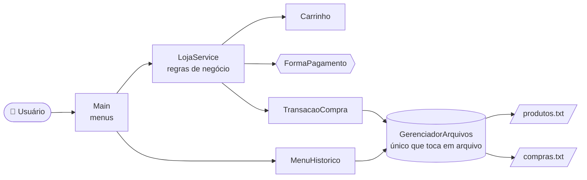
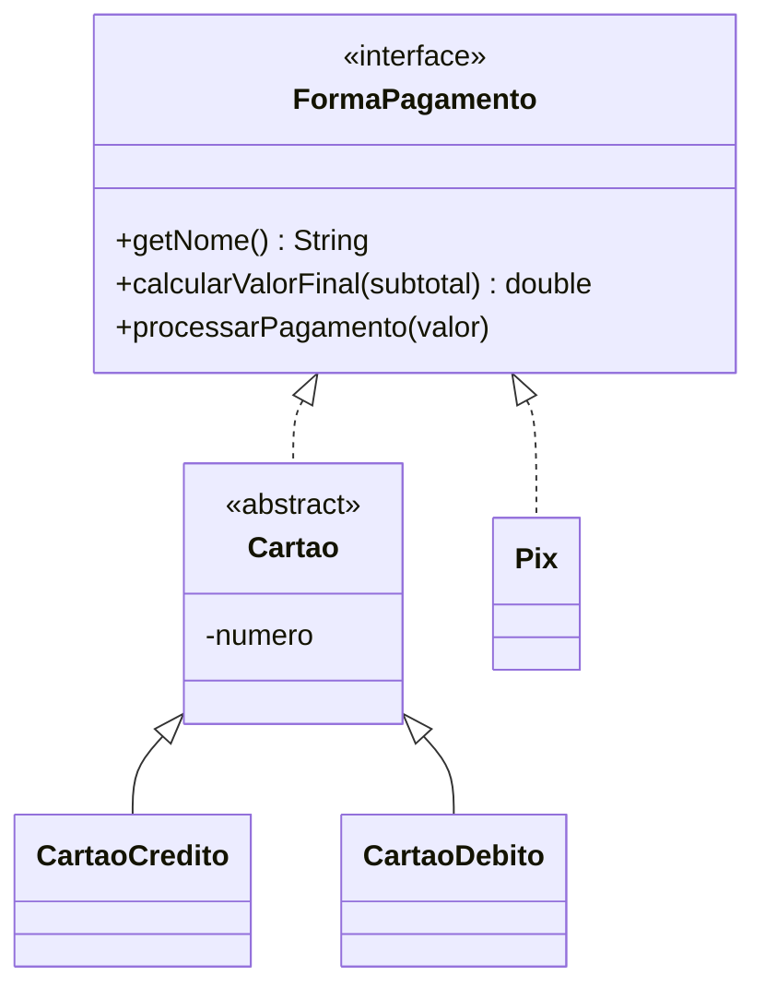
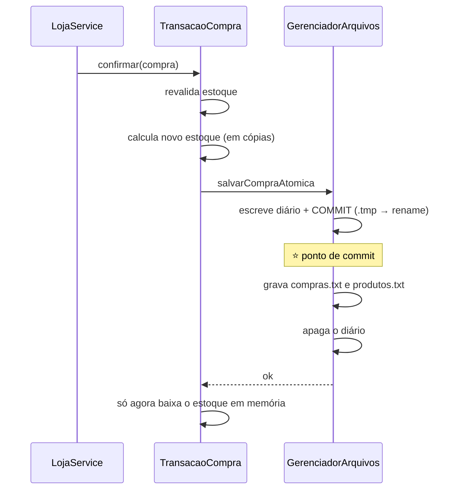

<div align="center">

```
 _     ___      _   _    __     _____ ____ _____ _   _   _    _
| |   / _ \    | | /_\  \ \   / /_ _|  _ \_   _| | | | / \  | |
| |  | | | |_  | |/ _ \  \ \ / / | || |_) || | | | | |/ _ \ | |
| |__| |_| | |_| / ___ \  \ V /  | ||  _ < | | | |_| / ___ \| |___
|_____\___/ \___/_/   \_\  \_/  |___|_| \_\|_|  \___/_/   \_\_____|
```

# 🛒 Loja Virtual em Java

**Uma loja inteira dentro do terminal. Sem interface gráfica, sem banco de dados e sem frescura.**
Só Programação Orientada a Objetos, arquivos de texto e uma boa dose de cuidado com os dados.


</div>

---

## 🎬 Como é por dentro

Duas portas de entrada, dois papéis:

| 🧑‍💼 Administrador | 🛍️ Comprador |
|---|---|
| Cadastra, lista, consulta, edita e remove produtos | Navega pelo catálogo e monta o carrinho |
| Valida ID, preço e estoque antes de aceitar qualquer coisa | Adiciona, remove e altera quantidades |
| Tudo é salvo em arquivo na hora | Escolhe a forma de pagamento e recebe o resumo |
| | Consulta o histórico e o total gasto |

Uma compra de verdade, direto do terminal (saída real do programa):

```text
--- Seu carrinho ---
ID    Produto                     Qtd    Preço un.        Total
1     Mouse                         4     R$ 50,50    R$ 202,00
Subtotal: R$ 202,00

Forma de pagamento:
1 - Cartão de crédito (valor integral)
2 - Cartão de débito (10% de desconto)
3 - Pix (5% de desconto)

========== RESUMO DA COMPRA ==========
Compra #1 | 17/11/2026 03:32:19
Comprador: Ana
--------------------------------------
Mouse                  4 x R$     50,50 = R$     202,00
--------------------------------------
Subtotal:    R$     202,00
Desconto:    R$      20,20 (Cartão de débito)
VALOR FINAL: R$     181,80
======================================
```

---

## 🚀 Rodando em 30 segundos

Precisa só do **Java 11 ou superior**.

**Linux / macOS**
```bash
javac -encoding UTF-8 -d out $(find src -name "*.java")
java -cp out app.Main
```

**Windows (CMD)**
```bat
chcp 65001
dir /s /b src\*.java > fontes.txt
javac -encoding UTF-8 -d out @fontes.txt
java -cp out app.Main
```

> 📁 A pasta `dados/` nasce sozinha na primeira execução, dentro da pasta de onde você iniciou o programa.
> Feche, abra de novo, e tudo continua lá: produtos, estoque e histórico.

---

## 🧩 Quem faz o quê



A regra de ouro do projeto: **cada camada tem um trabalho só.**
O `Main` só conversa com o usuário, o `LojaService` só decide, e o `GerenciadorArquivos` é a **única** classe que sabe que arquivos existem.

```
src/
├── model/        Produto · ItemCarrinho · Carrinho · ItemCompra · Compra
├── pagamento/    FormaPagamento · Cartao · CartaoCredito · CartaoDebito · Pix
├── repository/   GerenciadorArquivos
├── exception/    ProdutoInvalido · EstoqueInsuficiente · PagamentoRecusado · Persistencia
└── app/          Main · LojaService · TransacaoCompra · MenuHistorico
```

---

## 💳 Polimorfismo na prática: três jeitos de pagar, zero `if` por tipo



| Forma | Regra | Quando é recusado |
|---|---|---|
| 💳 Cartão de crédito | Valor integral | Número sem 16 dígitos |
| 💳 Cartão de débito | **10% de desconto** | Número sem 16 dígitos |
| ⚡ Pix | **5% de desconto** | Chave vazia |

Na hora de pagar, o `LojaService` só diz `pagamento.calcularValorFinal(...)` e `pagamento.processarPagamento(...)`.
Ele não faz a menor ideia se é crédito, débito ou Pix, e cada objeto sabe o que fazer. Se amanhã surgir o *Boleto*, é só criar uma classe nova: **nenhuma linha da compra muda.**

> O único `switch` do projeto está no menu e serve só para decidir qual objeto criar.

---

## 🛡️ "E se o programa cair no meio da compra?"

Essa foi a pergunta que mais nos deu trabalho (e mais orgulho). Finalizar uma compra mexe em **dois arquivos** (compra + estoque), e uma queda de energia entre um e outro poderia deixar um estrago: estoque descontado sem compra, ou compra sem desconto de estoque.

A solução tem duas camadas:

**1. Na memória: grava primeiro, atualiza depois.**
O estoque novo é calculado em *cópias*. Só depois que o arquivo foi gravado com sucesso é que o estoque real muda.

**2. No arquivo: diário + rename atômico.**



Se a energia acabar **antes** do commit, nada foi alterado. Se acabar **depois**, o programa termina o serviço sozinho na próxima vez que abrir (`[Recuperação] Compra pendente concluída com sucesso.`).

📄 Os detalhes estão no [`JUSTIFICATIVA.md`](JUSTIFICATIVA.md).

---

## 🧊 Preço congelado no tempo

Cada compra guarda uma "foto" dos itens: nome e preço **da hora em que você comprou**.
Se o administrador mudar o mouse de R$ 50,50 para R$ 99,00 amanhã, o seu histórico continua dizendo R$ 50,50. A classe `Compra` é imutável, sem setters.

---

## 🧯 Exceções: quando algo dá errado, o programa continua de pé

| Exceção | Situação | Reação |
|---|---|---|
| `ProdutoInvalidoException` | ID duplicado, preço ≤ 0, estoque negativo, produto inexistente | Mensagem clara e volta ao menu |
| `EstoqueInsuficienteException` | Pediu mais do que tem (ao adicionar, alterar ou finalizar) | Mostra *solicitado × disponível* |
| `PagamentoRecusadoException` | Cartão ou chave Pix inválidos | Compra não finalizada, carrinho preservado |
| `PersistenciaException` | Erro ao ler/gravar arquivo, ou arquivo corrompido | Operação desfeita, programa continua |
| `NumberFormatException` | Digitou "abc" onde era número | Pergunta de novo |

Nenhuma exceção é engolida em silêncio: cada uma tem consequência tratada.

---

## 🗂️ O que vai parar nos arquivos

```text
dados/produtos.txt   →  1;Mouse;50.5;6
dados/compras.txt    →  1;2026-11-17T03:32:19;Ana;Cart%C3%A3o+de+d%C3%A9bito;202.0;20.2;181.8;1,Mouse,50.5,4
```

Textos livres (nomes, comprador) são gravados com URL-encoding. Assim, um produto chamado `Mouse; Gamer | RGB` não quebra o arquivo.

---

## 👥 Equipe

| | Responsabilidade |
|---|---|
| **Francisco Gielsson**  | `Produto`, `Carrinho`, `ItemCarrinho`, formas de pagamento (polimorfismo), `LojaService`, menus do `Main` |
| **Kaik Anderson**  | `GerenciadorArquivos`, `Compra`, `ItemCompra`, `TransacaoCompra`, `MenuHistorico`, exceções, consistência |

<div align="center">

*Feito para a disciplina de Programação Orientada a Objetos* ☕

</div>
